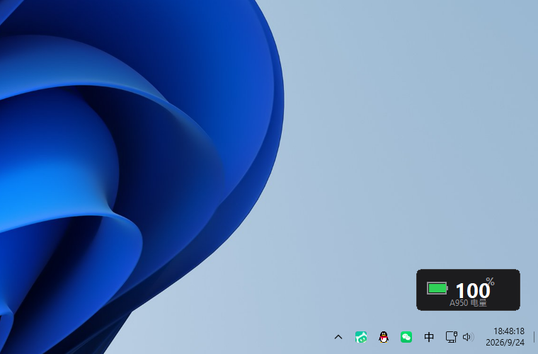
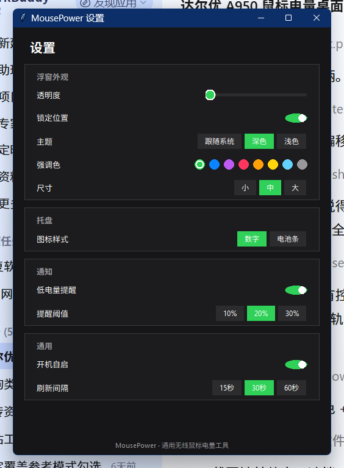
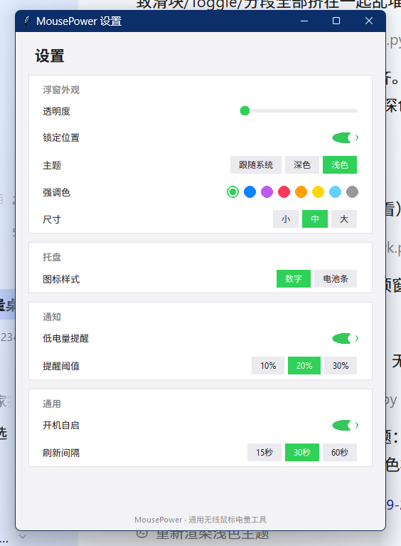

<div align="center">

# 🔋 MousePower

**通用无线鼠标电量桌面工具 — 让任意电脑的无线鼠标都能实时显示电量**

托盘数字图标 · 置顶浮窗 · 私有协议自动探测 · 深浅主题 · 自由定制

`Windows 10/11` · `免驱动后台常驻` · `Qt 界面` · `单文件 exe 约 56MB`


</div>

---

## ✨ 特性

- **三层通用电量检测**：蓝牙鼠标开箱即用（走 Windows 系统电池缓存）；2.4G 接收器设备通过厂商协议插件扩展；固件遵循 USB-IF 电池规范的设备直接走标准 HID 通道
- **私有协议自动探测**：遇到陌生 2.4G 接收器，设置里点「打开协议探测」，程序自动遍历命令码 × 12 种校验和算法 × 通道配对，一分钟内试出该鼠标的电量协议并永久记住（内置达尔优 A950 实测命中）
- **电池造型浮窗**：一个电池图标 + 内部百分比数字，一条轮廓线、没有卡片背景和投影；电池内部填充色跟随强调色，低电量自动转为橙 / 红
- **鼠标点击穿透（默认）**：浮窗纯显示，点击直接落到下层软件，不遮挡任何操作
- **移动位置模式**：托盘菜单点「移动位置」后可拖动浮窗，右上角出现 ✓，确认后自动保存位置并恢复穿透
- **系统托盘**：数字块 / 电池条两种图标，颜色跟随强调色与浮窗一致，悬停显示设备与电量详情
- **深度自定义**：不透明度 · 深/浅/跟随系统主题 · 8 色 Fluent 强调色 · 三档尺寸 · 屏幕四角预设
- **Win11 风格设置窗口**：圆角卡片 + Fluent 色板 + 自绘滑块/开关，所有改动即时生效、自动保存
- **多设备可选**：接多只鼠标时，设置里「监控设备 → 重新检测」列出能读到电量的设备并指定监控对象
- **读数时效如实标注**：鼠标休眠导致读取失败时沿用上次有效值，并在悬停提示里写明是多久前的读数
- **低电量提醒**：低于阈值弹 Windows 原生通知，同一轮只提醒一次
- **轻量常驻**：后台内存占用低，厂商驱动（如达尔优 OemDrv）可完全关闭，不影响读数

## 📸 截图

| 置顶浮窗 | 桌面效果 |
|---|---|
|  |  |

| 设置窗口 · 深色 | 设置窗口 · 浅色 |
|---|---|
|  |  |

## 🧭 三层检测架构

```
扫描系统全部 HID / 蓝牙设备 → 识别鼠标与接收器
   │
   ├─ L1 系统标准层（零逆向，覆盖率最高）
   │    ├─ 蓝牙鼠标: Windows PnP 电池缓存 (BTHENUM / BTHLE)
   │    └─ USB / 2.4G: HID Battery System Usage Page (0x85)
   │
   ├─ L2 厂商协议插件层（VID/PID 匹配，开放扩展）
   │    └─ 内置: 达尔优 A950 / Compx 系列接收器
   │
   ├─ L2.5 探测协议层（自动探测器试出的私有协议，持久化注册表）
   │    └─ %APPDATA%\MousePower\probed_protocols.json
   │
   └─ L3 兜底层
         └─ 不支持电量的设备诚实显示"电量不可读"，绝不误导
```

### 支持设备

| 连接方式 | 支持情况 |
|---|---|
| 蓝牙无线鼠标 | ✅ 绝大多数开箱即用（Windows 标准电池缓存） |
| 2.4G 接收器 · 走标准 HID 电池通道的型号 | ✅ |
| 2.4G 接收器 · 达尔优 A950 系列（Compx 方案） | ✅ 内置私有协议（带校验和的 `0x04` 电量命令） |
| 2.4G 接收器 · 其他品牌（可写厂商页 + 帧式协议） | 🔍 可用「协议探测」自动试出，试出后永久生效 |
| 有线鼠标 | ➖ 普遍不上报电量，显示"电量不可读" |

> **关于 2.4G 鼠标**：部分接收器固件只在收到**带正确校验和的私有命令**时才返回电量，
> 普通读取只会拿到固定值。本项目已内置达尔优 A950 系列的完整实现；
> 其他品牌点「打开协议探测」让程序自动试参数（命令码 / 校验和 / 电量字节），
> 试出的协议写入本地注册表，下次扫描直接使用。

新增品牌只需在 `core/providers/` 实现一个 Provider 类（约 80 行），无需改动框架。
`tools/` 下附带了协议探测与端到端验证脚本（自动探测器实测、托盘线程回归、
打包产物自检），可作为新设备的接入起点。

## 📦 安装

前往 [Releases](../../releases) 下载：

- **`MousePower-Setup-vX.X.X.exe`** — 安装版，内置 Windows 11 官方主题安装向导（深浅色跟随系统）
- **`MousePower-vX.X.X-portable.zip`** — 便携版，解压即用

> 首次运行如遇 Windows SmartScreen 提示，点击 **更多信息 → 仍要运行** 即可
> （程序未做代码签名，此为正常提示；全部源码开源可自行审查或从源码构建）

## 🚀 使用

1. 启动后自动扫描设备，电池浮窗与托盘图标显示当前鼠标电量
2. 浮窗默认**鼠标穿透**（点击不遮挡下层软件）；**要挪动位置**：托盘图标右键 → 「移动位置」，拖动浮窗到目标位置后点右上角的 **✓** 确认（会自动保存并恢复穿透）；浮窗**右键**也有同样的菜单
3. **右键托盘图标**：立即刷新 / 移动位置 / 显示隐藏浮窗 / 设置 / 退出
4. **设置窗口**：不透明度、屏幕位置、主题、强调色、尺寸、通知阈值、开机自启、刷新间隔
5. **电量显示 `--`？**：设置 → 私有协议探测 → 打开协议探测 → 选中设备点「开始探测」。
   探测为保守遍历（每命令一帧、帧间隔 80ms），约 1 分钟出结果；
   成功后协议自动保存，主程序即刻按新协议读数。个别设备探测后短暂"降级"
   （读回全 0），数十秒到几分钟自恢复，无需拔插。

## 🛠️ 从源码构建

```bash
# 环境: Windows 10/11 + Python 3.13
pip install PySide6 hidapi pystray pillow pyinstaller

# 直接运行（Qt 版）
pythonw src\mousepower\main_qt.py

# 一键构建 exe + Inno Setup 7 安装包 + 便携包（默认 Qt 版；"tk" 为旧版）
python build.py
```

> 打包用 `mousepower_qt.spec`：只保留 QtCore/QtGui/QtWidgets，
> 排除 WebEngine/3D/Quick/Multimedia 等无关模块。注意不要排除
> `shiboken6.Shiboken`（PySide6 绑定核心，排除会导致启动失败）。

## 📁 项目结构

```
src/mousepower/
├── main_qt.py             # Qt 版入口：装配 + 托盘线程 + 跨线程信号桥
├── main.py                # （旧 tkinter 版入口）
├── config.py              # %APPDATA%\MousePower\config.json 持久化

├── dpi.py                 # DPI 感知与像素换算
├── core/
│   ├── winhid.py          # 统一的 Win32/HID ctypes 声明层（restype/结构体/安全读）
│   ├── scanner.py         # 设备扫描 / 分层识别管线
│   ├── device.py          # DeviceInfo / BatteryInfo 模型
│   ├── std_battery.py     # L1: HID 标准电池 (ctypes hid.dll)
│   ├── bt_battery.py      # L1: 蓝牙 PnP 电池属性 (cfgmgr32)
│   ├── hid_prober.py      # L2.5: 私有协议自动探测器
│   ├── probed_provider.py # 探测参数驱动的通用 Provider
│   ├── probed_registry.py # 探测协议持久化注册表
│   └── providers/         # L2: 厂商协议插件
│       ├── base.py        #   Provider 接口
│       └── dareu_compx.py #   达尔优 A950 / Compx 协议
├── qt/                    # Qt 界面层
│   ├── widget.py          #   电池浮窗（逐像素透明 + 点击穿透）
│   ├── settings.py        #   Win11 风格设置窗口
│   ├── probe_window.py    #   协议探测窗口（日志 + 导出 Provider 代码）
│   └── style.py           #   QSS 样式表生成
└── ui/
    ├── tray.py            # 系统托盘 + 通知
    └── theme.py           # 主题色板
```

## 🗺️ Roadmap

- [x] 多设备支持：可选监控设备
- [ ] 罗技 HID++ 协议支持
- [ ] 中英双语界面
- [ ] 每设备独立浮窗（同时显示多只鼠标）

## 📄 License

[MIT](LICENSE)

---

<div align="center">

**English**

A lightweight Windows tray & floating widget that shows battery level for
**any** wireless mouse — Bluetooth mice work out of the box via the Windows
battery cache, 2.4G dongles are supported through pluggable vendor-protocol
providers (Dareu A950 / Compx built-in). Deeply customizable: opacity, lock
position, dark/light/auto theme, 8 accent colors, 3 sizes.

</div>
